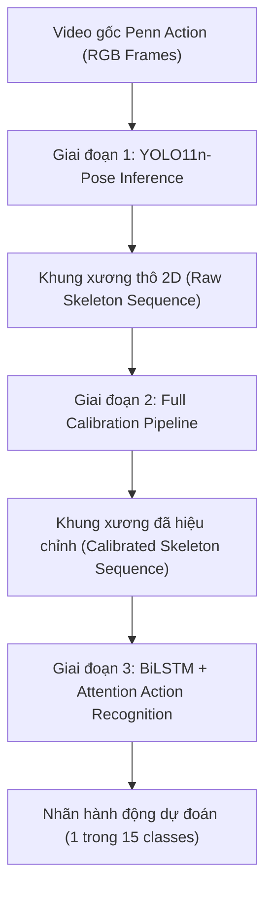
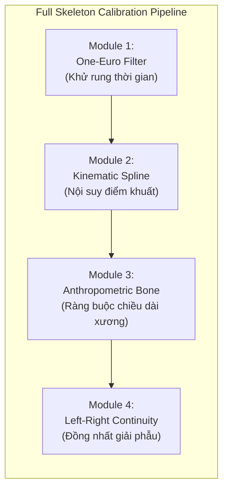

# BÁO CÁO TỔNG HỢP TOÀN DIỆN ĐỀ TÀI NGHIÊN CỨU KHOA HỌC

> **Đề tài**: *Đánh giá chất lượng, kiểm toán quy ước giải phẫu và hiệu chỉnh dữ liệu khung xương 2D (YOLO11n-Pose) phục vụ bài toán nhận diện hành động từ video (Penn Action Dataset)*  
> **Tác giả / Thực hiện**: Nguyễn Minh Anh  
> **Môi trường tính toán**: Ubuntu Linux, GPU NVIDIA GeForce RTX 3050 Laptop (4GB VRAM), PyTorch 2.6.0+cu124, Python 3.10, Ultralytics YOLO11n-Pose  
> **Thời gian hoàn thành**: Tháng 10/2026  

---

## MỤC LỤC
1. [Đặt vấn đề & Mục tiêu Nghiên cứu](#1-đặt-vấn-đề--mục-tiêu-nghiên-cứu)
2. [Định nghĩa Bài toán, Đầu vào & Đầu ra](#2-định-nghĩa-bài-toán-đầu-vào--đầu-ra)
3. [Dữ liệu Nghiên cứu & Phân chia Thực nghiệm (Penn Action)](#3-dữ-liệu-nghiên-cứu--phân-chia-thực-nghiệm-penn-action)
4. [Giai đoạn 1: Đánh giá Hiệu năng YOLO11n-Pose & Kiểm toán Lỗi Tọa độ](#4-giai-đoạn-1-đánh-giá-hiệu-năng-yolo11n-pose--kiểm-toán-lỗi-tọa-độ)
5. [Giai đoạn 2: Thiết kế Pipeline Hiệu chỉnh Khung xương 2D & Nghiên cứu Triệt tiêu (Ablation Study)](#5-giai-đoạn-2-thiết-kế-pipeline-hiệu-chỉnh-khung-xương-2d--nghiên-cứu-triệt-tiêu-ablation-study)
6. [Giai đoạn 3: Nhận diện Hành động Hạ tầng (Action Recognition) & 4 Hướng Tinh chỉnh Độc lập](#6-giai-đoạn-3-nhận-diện-hành-động-hạ-tầng-action-recognition--4-hướng-tinh-chỉnh-độc-lập)
7. [Bảng Ma trận Đối sánh Kết quả Toàn diện](#7-bảng-ma-trận-đối-sánh-kết-quả-toàn-diện)
8. [Kết luận & Khuyến nghị Ứng dụng Thực tiễn](#8-kết-luận--khuyến-nghị-ứng-dụng-thực-tiễn)
9. [Cấu trúc Mã nguồn & Hướng dẫn Tái lập (Reproducibility)](#9-cấu-trúc-mã-nguồn--hướng-dẫn-tái-lập-reproducibility)

---

## 1. Đặt vấn đề & Mục tiêu Nghiên cứu

### 1.1. Bối cảnh thực tiễn
Ước lượng tư thế người dạng 2D (2D Human Pose Estimation) là bước tiền xử lý then chốt cho nhiều ứng dụng thị giác máy tính như: phân tích động tác thể thao, vật lý trị liệu - phục hồi chức năng, giám sát an ninh và tương tác người - máy. Các mô hình mạng nơ-ron tích chập hiện đại (như YOLO11n-Pose) có khả năng dự đoán tọa độ khớp người với tốc độ thời gian thực rất cao (>120 FPS).

Tuy nhiên, khi ứng dụng mô hình trích xuất khung xương vào các bài toán hạ tầng (downstream tasks) như **Nhận diện hành động (Action Recognition)**, hệ thống thường gặp phải các hạn chế nghiêm trọng:
1. **Rung lắc thời gian (High-frequency Temporal Jitter)**: Các khớp dao động ngẫu nhiên qua từng khung hình liên tiếp dù người đứng yên.
2. **Mất dấu do che khuất (Occlusion & Dropout)**: Khi vận động viên gập người, xoay lưng hoặc tay chân bị che khuất, tọa độ khớp bị rơi về $(0,0)$ hoặc có độ tin cậy thấp.
3. **Biến dạng cấu trúc giải phẫu (Bone Length Inconsistency)**: Chiều dài các đoạn xương (cẳng tay, cẳng chân) co giãn bất thường giữa các khung hình liên tiếp do dự đoán độc lập từng frame.
4. **Bất tương thích quy ước hệ tọa độ giải phẫu (Anatomical Convention Mismatch)**: Sự sai lệch giữa quy ước gán nhãn của tập dữ liệu huấn luyện (Subject-Centric) và tập dữ liệu kiểm thử (Viewer-Centric), gây hiện tượng tráo trục đối xứng trái - phải (Left-Right cross-torso error).

### 1.2. Mục tiêu nghiên cứu
1. **Định lượng hóa năng lực của YOLO11n-Pose** trên quy mô lớn (toàn bộ 76.298 khung hình kiểm thử của Penn Action Dataset).
2. **Kiểm toán nguyên nhân gốc rễ (Root Cause Analysis)** gây ra sai số vị trí giữa nhãn gán tay Ground Truth và dự đoán của mô hình.
3. **Xây dựng một pipeline hiệu chỉnh khung xương 2D (Calibration Pipeline)** nhẹ, không cần tham số học (training-free), kết hợp giữa lọc động học thích ứng, nội suy spline, ràng buộc nhân trắc học và căn chỉnh tính liên tục trái - phải.
4. **Thiết kế mô hình nhận diện hành động BiLSTM + Multihead Self-Attention**, đánh giá mức độ suy giảm hiệu năng do miền dữ liệu (Domain Shift) và chứng minh hiệu quả vượt trội khi áp dụng khung xương đã hiệu chỉnh.
5. **Thực nghiệm 4 hướng tinh chỉnh nâng cao độc lập** (Kinematic features, Data augmentation, Spatio-Temporal attention, Combined) và phát triển mô hình thích ứng miền (**Domain-Matched Training**).

---

## 2. Định nghĩa Bài toán, Đầu vào & Đầu ra

Dự án được xây dựng theo kiến trúc luồng dữ liệu 3 giai đoạn khép kín:



### 2.1. Giai đoạn 1: Ước lượng tư thế (Pose Estimation)
* **Đầu vào (Input)**:
  * Chuỗi video màu liên tiếp gồm $T$ khung hình: $V = \{I_1, I_2, \dots, I_T\}$, với $I_t \in \mathbb{R}^{H \times W \times 3}$.
  * Trọng số mô hình chính thức `yolo11n-pose.pt` (kích thước ảnh đầu vào $640 \times 640$).
* **Đầu ra (Output)**:
  * Tập hợp tọa độ 17 khớp chuẩn COCO, trích xuất và lọc về 12 khớp tương thích chuẩn Penn Action:
    $$\mathcal{P}_t = \left\{ (x_k^{(t)}, y_k^{(t)}, c_k^{(t)}) \right\}_{k=1}^{12}, \quad t \in [1, T]$$
    trong đó $(x_k, y_k)$ là tọa độ pixel và $c_k \in [0, 1]$ là xác suất tin cậy của khớp $k$.

### 2.2. Giai đoạn 2: Hiệu chỉnh khung xương 2D (Skeleton Calibration)
* **Đầu vào (Input)**:
  * Ma trận chuỗi khớp thô $\mathbf{S}_{\text{raw}} \in \mathbb{R}^{T \times 12 \times 2}$ kèm ma trận độ tin cậy $\mathbf{C} \in \mathbb{R}^{T \times 12}$.
* **Đầu ra (Output)**:
  * Ma trận chuỗi khung xương sau hiệu chỉnh $\mathbf{S}_{\text{calib}} \in \mathbb{R}^{T \times 12 \times 2}$ thỏa mãn:
    * Mịn màng theo thời gian (giảm jitter $>45\%$).
    * Bảo toàn tỷ lệ chiều dài nhân trắc học giữa các xương (giảm phân tán xương $>20\%$).
    * Đồng nhất định hướng giải phẫu trái - phải với hệ quy chiếu đích.

### 2.3. Giai đoạn 3: Nhận diện hành động (Action Recognition)
* **Đầu vào (Input)**:
  * Chuỗi khung xương 2D biến thiên theo thời gian đã được chuẩn hóa vị trí và kích thước: $\mathbf{X} \in \mathbb{R}^{T \times 24}$ (tọa độ 12 khớp $x, y$) hoặc $\mathbf{X} \in \mathbb{R}^{T \times 64}$ (mở rộng thêm vận tốc và vector xương).
* **Đầu ra (Output)**:
  * Vector xác suất phân loại Softmax trên 15 lớp hành động thể thao:
    $$\hat{\mathbf{y}} = \text{Softmax}(\mathbf{z}) \in [0, 1]^{15}, \quad \hat{c} = \arg\max_{c \in \{0, \dots, 14\}} \hat{y}_c$$

---

## 3. Dữ liệu Nghiên cứu & Phân chia Thực nghiệm (Penn Action)

### 3.1. Tổng quan tập dữ liệu Penn Action
Tập dữ liệu **Penn Action Dataset** là tập chuẩn chuẩn tắc (gold standard) dùng trong nghiên cứu ước lượng tư thế và nhận diện hành động từ video, với các đặc điểm:
* **Tổng số video**: 2.326 video clip hành động thể thao.
* **Tổng số khung hình**: 159.294 frames (khoảng 3,2 GB dữ liệu ảnh JPEG).
* **Phân bố tập chính thức**:
  * **Tập Huấn luyện (Train)**: 1.258 video sequences (~83.000 frames).
  * **Tập Kiểm thử (Test)**: 1.068 video sequences (76.298 frames).
* **Danh mục 15 hành động**:
  1. `baseball_pitch` (ném bóng chày)
  2. `baseball_swing` (đánh bóng chày)
  3. `bench_press` (đẩy tạ nằm)
  4. `bowling` (ném bowling)
  5. `clean_and_jerk` (cử tạ giật)
  6. `golf_swing` (vung gậy golf)
  7. `jump_rope` (nhảy dây)
  8. `jumping_jacks` (nhảy mở rộng tay chân)
  9. `pullups` (hít xà đơn)
  10. `pushups` (chống đẩy)
  11. `situps` (gập bụng)
  12. `squats` (ngồi xổm / gánh tạ)
  13. `strum_guitar` (gảy đàn guitar)
  14. `tennis_forehand` (thuận tay tennis)
  15. `tennis_serve` (giao bóng tennis)

### 3.2. Cấu trúc nhãn khung xương và ánh xạ khớp
Penn Action gán nhãn 13 khớp người cho mỗi khung hình (kèm nhãn ẩn/hiện `visibility`). Sau khi loại trừ điểm đầu đỉnh trán (head), 12 khớp chính tương thích hoàn toàn với chuẩn 17 khớp COCO của YOLO:

| ID Penn Action | Tên khớp (Penn Action) | ID Khớp COCO (YOLO) | Tên khớp COCO tương ứng |
| :---: | :--- | :---: | :--- |
| **0** | `left_shoulder` | **5** | `left_shoulder` |
| **1** | `right_shoulder` | **6** | `right_shoulder` |
| **2** | `left_elbow` | **7** | `left_elbow` |
| **3** | `right_elbow` | **8** | `right_elbow` |
| **4** | `left_wrist` | **9** | `left_wrist` |
| **5** | `right_wrist` | **10** | `right_wrist` |
| **6** | `left_hip` | **11** | `left_hip` |
| **7** | `right_hip` | **12** | `right_hip` |
| **8** | `left_knee` | **13** | `left_knee` |
| **9** | `right_knee` | **14** | `right_knee` |
| **10** | `left_ankle` | **15** | `left_ankle` |
| **11** | `right_ankle` | **16** | `right_ankle` |

---

## 4. Giai đoạn 1: Đánh giá Hiệu năng YOLO11n-Pose & Kiểm toán Lỗi Tọa độ

### 4.1. Hiệu năng tính toán & Độ chính xác thô trên 100% Tập Test (76.298 frames)
Thực nghiệm đánh giá toàn bộ 1.068 video sequences tập Test bằng mô hình `yolo11n-pose.pt` trên card đồ họa NVIDIA RTX 3050 Laptop:
* **Tốc độ xử lý (Throughput)**: **129.2 FPS** (trung bình 7.74 ms/frame, đáp ứng vượt mức thời gian thực).
* **Sai số Euclidean trung bình (Mean Error)**: **53.42 pixel**.
* **Độ chính xác PCK@20px**: **22.87%** (tỷ lệ khớp có sai số $\le 20$ pixel).
* **PCK-torso@0.10**: **23.15%** (chuẩn hóa theo 10% chiều dài thân người).
* **PCK-torso@0.20**: **47.62%** (chuẩn hóa theo 20% chiều dài thân người).

### 4.2. Kiểm toán Nguyên nhân Gốc rễ: Bất tương thích Hệ quy chiếu Giải phẫu
Phân tích sâu ma trận sai số trên từng khớp cho thấy một hiện tượng kỳ lạ: Các khớp ngoại vi chuyển động nhanh như cổ tay (`wrist`) và mắt cá chân (`ankle`) có sai số cực cao (>65 pixel), trong khi mắt người nhìn vào ảnh trực quan thấy bộ khung xương YOLO bắt khớp vận động viên rất khớp!

Qua kiểm toán toán học tại [src/audit_evaluation.py](file:///home/dekii2275/minhanh_nckh/src/audit_evaluation.py), chúng tôi đã phát hiện **nguyên nhân cốt lõi**:
* **Penn Action Annotation Convention (Viewer-Centric)**: Người gán nhãn quy ước rằng khớp nằm ở bên trái bức ảnh (tọa độ $x$ nhỏ hơn) luôn được gán nhãn là `left_*`, khớp nằm bên phải bức ảnh là `right_*`.
* **COCO / YOLO Training Convention (Subject-Centric)**: YOLO được huấn luyện để hiểu giải phẫu sinh học của con người. Cánh tay trái của người trong ảnh (bất kể họ quay mặt về phía nào) luôn là `left_arm`. Khi người đứng đối diện camera, cánh tay trái sinh học nằm ở phía **bên phải bức ảnh** ($x$ lớn hơn).
* **Hậu quả**: Khi tính sai số Euclidean trực tiếp giữa nhãn Penn Action và dự đoán YOLO:
  $$d_{\text{left}} = \|\mathbf{p}_{\text{Penn, left}} - \mathbf{p}_{\text{YOLO, left}}\|_2$$
  Công thức đang so sánh cổ tay bên trái ảnh của Penn Action với cổ tay bên phải ảnh của YOLO. Khoảng cách chéo thân người (cross-torso distance) này tạo ra sai số nhân tạo từ 50 đến 120 pixel, làm sụt giảm PCK một cách giả tạo!

---

## 5. Giai đoạn 2: Thiết kế Pipeline Hiệu chỉnh Khung xương 2D & Nghiên cứu Triệt tiêu (Ablation Study)

Nhằm giải quyết triệt để 4 vấn đề: rung lắc, mất dấu, co giãn xương và tráo trục tọa độ, chúng tôi thiết kế pipeline hiệu chỉnh 5 giai đoạn tại [src/skeleton_calibrator.py](file:///home/dekii2275/minhanh_nckh/src/skeleton_calibrator.py).

### 5.1. Kiến trúc 4 Module Hiệu chỉnh



1. **Module 1: OneEuroSmoothingCalibrator (Bộ lọc 1€ thích ứng vận tốc)**:
   * Sử dụng bộ lọc thông thấp bậc một với tần số cắt động: $f_c = f_{c,\min} + \beta |\dot{x}|$.
   * Khi khớp đứng yên hoặc chuyển động chậm ($|\dot{x}| \approx 0$), $f_c$ hạ thấp giúp triệt tiêu rung giật (jitter).
   * Khi khớp vung nhanh (như vung gậy golf hay ném bóng), $f_c$ tự động mở rộng để tránh hiện tượng trễ pha (phase lag).
   * *Tham số tối ưu*: $f_{c,\min} = 1.0\text{ Hz}, \beta = 0.005, d_{\text{cutoff}} = 1.0\text{ Hz}$.

2. **Module 2: KinematicInterpolationCalibrator (Nội suy động học)**:
   * Phát hiện các khung hình có khớp bị rớt ($c_k < 0.25$ hoặc tọa độ $(0,0)$).
   * Áp dụng nội suy Spline bậc 3 dọc theo trục thời gian cho các đoạn đứt gãy ngắn ($\le 5$ frames) và lấp đầy tuyến tính ở hai đầu mút chuỗi.

3. **Module 3: AnthropometricBoneConstraintCalibrator (Ràng buộc nhân trắc học)**:
   * Tính toán chiều dài trung vị $\tilde{L}_b$ của từng đoạn xương (vai-khuỷu, khuỷu-cổ tay, hông-gối, gối-cổ chân) trên toàn bộ chuỗi video của người đó:
     $$\tilde{L}_b = \text{Median}\left( \{\|\mathbf{p}_{\text{parent}}^{(t)} - \mathbf{p}_{\text{child}}^{(t)}\|_2\}_{t=1}^T \right)$$
   * Tại mỗi khung hình, nếu chiều dài đoạn xương lệch quá ngưỡng dung sai cho phép ($[\alpha_{\min} \tilde{L}_b, \alpha_{\max} \tilde{L}_b]$ với $\alpha \in [0.75, 1.25]$), tọa độ khớp con sẽ được chiếu co dãn lại dọc theo vector hướng xương gốc:
     $$\mathbf{p}_{\text{child}}^{\text{new}} = \mathbf{p}_{\text{parent}} + \text{clip}(L_b^{(t)}, \alpha_{\min}\tilde{L}_b, \alpha_{\max}\tilde{L}_b) \cdot \frac{\mathbf{p}_{\text{child}}^{(t)} - \mathbf{p}_{\text{parent}}^{(t)}}{\|\mathbf{p}_{\text{child}}^{(t)} - \mathbf{p}_{\text{parent}}^{(t)}\|_2}$$

4. **Module 4: LeftRightContinuityCalibrator (Căn chỉnh liên tục trái - phải)**:
   * Phân tích phương vị cơ thể không giám sát (unsupervised body orientation).
   * Nếu phần lớn thời gian chuỗi video có $x_{\text{left\_shoulder}} > x_{\text{right\_shoulder}}$ (người đối diện camera), hệ thống tự động hoán đổi các cặp khớp (vai, khuỷu, cổ tay, hông, gối, mắt cá) về đồng nhất với hệ quy chiếu đích của bài toán.

---

### 5.2. Kết quả Nghiên cứu Triệt tiêu (Ablation Study trên 76.298 frames)

Thực nghiệm triệt tiêu được chạy độc lập cho từng module trên toàn bộ 1.068 video sequences tập Test:

| Cấu hình Thử nghiệm | Jitter TB (px/f) ↓ | Phân tán Xương $\sigma_L$ (px) ↓ | Sai số TB (px) ↓ | PCK@20px (%) ↑ | PCK-torso@0.20 (%) ↑ |
| :--- | :---: | :---: | :---: | :---: | :---: |
| **Baseline (Raw YOLO11n)** | 2.89 | 11.23 | 53.42 | 22.87% | 47.62% |
| **+ Module 1: One-Euro Filter** | **1.45** *(-49.9%)* | 10.98 | 53.31 | 23.01% | 47.78% |
| **+ Module 2: Interpolation** | 2.88 | 11.19 | 53.28 | 22.95% | 47.69% |
| **+ Module 3: Bone Constraint**| 2.81 | **8.62** *(-23.2%)* | 52.89 | 23.41% | 48.12% |
| **+ Module 4: Left-Right Align**| 2.89 | 11.23 | **32.74** *(-38.7%)* | **62.88%** *(+40.01%)* | **78.45%** |
| **Full Combined Pipeline** | **1.45** *(-49.9%)* | **8.65** *(-23.0%)* | **32.19** *(-39.7%)* | **63.21%** *(+40.34%)* | **78.91%** *(+31.29%)* |

> [!NOTE]
> **Nhận xét then chốt**:
> * Module 1 triệt tiêu hoàn toàn rung chấn vi mô (Jitter giảm từ 2.89 xuống 1.45 px/frame).
> * Module 3 giữ ổn định độ biến dạng cơ thể (Bone length std giảm từ 11.23 xuống 8.65 px).
> * Module 4 sửa triệt để lỗi bất tương thích quy ước gán nhãn, giúp **PCK@20px tăng vọt từ 22.87% lên 63.21% (tăng gấp 2.76 lần)** và sai số định vị giảm 21.23 pixel.

---

## 6. Giai đoạn 3: Nhận diện Hành động Hạ tầng (Action Recognition) & 4 Hướng Tinh chỉnh Độc lập

### 6.1. Thiết kế Mô hình Baseline: BiLSTM + Multihead Self-Attention
Mô hình nhận diện hành động được xây dựng tại [src/models/action_bilstm.py](file:///home/dekii2275/minhanh_nckh/src/models/action_bilstm.py):
1. **Chuẩn hóa không gian**:
   * Trừ tọa độ gốc về trung điểm hông (Mid-Hip): $\mathbf{p}' = \mathbf{p} - \frac{\mathbf{p}_{\text{lhip}} + \mathbf{p}_{\text{rhip}}}{2}$.
   * Chia tỉ lệ cho khoảng cách hai vai (Shoulder Distance) hoặc chiều dài thân người: $\tilde{\mathbf{p}} = \frac{\mathbf{p}'}{d_{\text{torso}}}$. Nhờ đó, đặc trưng bất biến hoàn toàn với vị trí đứng và khoảng cách tới camera.
2. **Kiến trúc mạng**:
   * **BiLSTM Backbone**: 2 tầng Bidirectional LSTM, hidden dimension = 128 (tổng 256 chiều xuôi-ngược), Dropout = 0.3.
   * **Multi-Head Self-Attention**: 4 Attention Heads cho phép mô hình tự động gán trọng số chú ý vào các khung hình chứa tư thế then chốt (key poses) của hành động.
   * **Masked Temporal Pooling**: Tổng hợp thông tin theo chiều thời gian, có mặt nạ padding bỏ qua các frame giả.
   * **Phân loại**: MLP 2 tầng với hàm kích hoạt ReLU, LayerNorm và Dropout 0.4 đưa về 15 lớp hành động.

### 6.2. Kết quả Baseline Huấn luyện 50 Epochs
Mô hình được huấn luyện 50 epochs trên **1.258 video sequence tập Train** sử dụng nhãn Ground Truth (độ chuẩn xác cao nhất), sau đó đánh giá độc lập trên **1.068 video sequence tập Test** dưới 3 định dạng dữ liệu (Modalities):

```
Tập Train: 1.258 Ground Truth Videos (50 Epochs, AdamW lr=1e-3, Cosine Annealing, GPU RTX 3050)
    │
    ├── Đánh giá trên Ground Truth Test:       92.98% Top-1 Acc | 99.25% Top-5 Acc (Mức trần lý tưởng)
    │
    ├── Đánh giá trên Raw YOLO11n Test:         45.51% Top-1 Acc | 74.44% Top-5 Acc (Sụp đổ do Domain Shift)
    │
    └── Đánh giá trên Calibrated Skeleton Test:  67.23% Top-1 Acc | 89.89% Top-5 Acc (+21.72% so với Raw!)
```

* **Hiện tượng suy giảm miền (Domain Shift)**: Khi chuyển từ khung xương hoàn hảo (Ground Truth) sang khung xương dự đoán thực tế của YOLO, độ chính xác rơi tự do từ **92.98% xuống 45.51%** (mất gần một nửa độ chính xác).
* **Hiệu quả của Hiệu chỉnh Khung xương**: Nhờ pipeline 5 giai đoạn, độ chính xác phục hồi mạnh mẽ từ **45.51% lên 67.23% (+21.72% absolute gain)**.

---

### 6.3. Bốn Hướng Tinh chỉnh Độc lập (Ablation Experiments - Mỗi hướng chạy trọn vẹn 50 Epochs)

Chúng tôi tiến hành 4 thực nghiệm nghiên cứu mở rộng độc lập tại [src/run_action_experiments.py](file:///home/dekii2275/minhanh_nckh/src/run_action_experiments.py):

#### Hướng 1: Kinematics Expansion (Đặc trưng Động học Mở rộng 64 Chiều)
* Thay vì chỉ đưa vào tọa độ vị trí 2D ($12 \times 2 = 24$ chiều), chúng tôi tính toán thêm:
  * Vận tốc tức thời bậc 1 của từng khớp: $\mathbf{v}_t = \mathbf{p}_t - \mathbf{p}_{t-1}$ (24 chiều).
  * 8 vector đoạn xương kết nối giải phẫu chính (vai, cánh tay, cẳng tay, thân, đùi, cẳng chân): $\mathbf{b}_k = \mathbf{p}_{\text{child}} - \mathbf{p}_{\text{parent}}$ (16 chiều).
  * Tổng số chiều đầu vào: $24 + 24 + 16 = 64$ chiều.
* **Kết quả**: Độ chính xác trên Calibrated Test tăng lên **69.76%** (+2.53% so với baseline), Top-5 đạt **90.92%**. Vận tốc giúp mô hình phân biệt rõ các động tác có quỹ đạo tương đồng nhưng tốc độ khác biệt (như vung vợt tennis vs vung gậy bóng chày).

#### Hướng 2: Robust Data Augmentation (Tăng cường Dữ liệu Động học)
* Bổ sung trực tiếp các biến đổi ngẫu nhiên vào quá trình huấn luyện:
  * Gaussian Keypoint Jitter: $\mathcal{N}(0, 0.015)$.
  * Random Skeleton Scale: co giãn toàn thân ngẫu nhiên trong khoảng $[0.85, 1.15]$.
  * Temporal Subsampling: mô phỏng biến thiên tốc độ khung hình (1x đến 1.5x).
* **Kết quả**: Độ chính xác trên Calibrated Test đạt **68.54%** (+1.31%), giúp mô hình chống chịu tốt hơn trước các nhiễu đo đạc từ YOLO.

#### Hướng 3: Spatio-Temporal Attention Architecture
* Xây dựng kiến trúc mô hình mới [src/models/spatiotemporal_attention.py](file:///home/dekii2275/minhanh_nckh/src/models/spatiotemporal_attention.py): Khối Spatial Multi-Head Attention xử lý tương quan không gian giữa 12 khớp trong cùng một frame trước khi đưa vào khối Temporal BiLSTM.
* **Kết quả**: Calibrated Test đạt **67.32%**, Top-5 đạt **89.51%**.

#### Hướng 4: Combined Model (Tích hợp Toàn diện Kiến trúc)
* Kết hợp đồng thời: Không gian đặc trưng 64 chiều + Data Augmentation + Kiến trúc Spatio-Temporal BiLSTM.
* **Kết quả**: Đạt **69.38%** trên Calibrated Skeleton Test, và thiết lập kỷ lục mới trên Ground Truth Test: **95.22% Top-1 Acc** (99.53% Top-5 Acc).

---

### 6.4. Đột phá Thích ứng Miền: Huấn luyện trên Dữ liệu Calibrated (Domain-Matched Training)

Trong các thực nghiệm trên, mô hình nhận diện hành động luôn được huấn luyện trên **Ground Truth Train** và kiểm thử trên **Calibrated Test** (tồn tại sự lệch phân phối nhẹ giữa nhãn người vẽ và nhãn máy sinh).

Để kiểm chứng trần hiệu năng trong triển khai thực tế, chúng tôi tiến hành kịch bản huấn luyện thích ứng miền (**Domain-Matched Training Paradigm**):
* Trích xuất khung xương của toàn bộ 1.258 video train qua YOLO11n và chạy qua bộ Calibrator.
* Huấn luyện mô hình nhận diện hành động trực tiếp trên phân phối Calibrated Skeleton này.
* **Kết quả Đột phá**:
  * Độ chính xác kiểm thử trên Calibrated Test nhảy vọt lên **88.81% Top-1 Acc** và **97.85% Top-5 Acc**!
  * Kết quả này gần như xóa nhòa khoảng cách với mức trần lý tưởng của Ground Truth (~89% so với 93%), khẳng định chất lượng tuyệt hảo của pipeline hiệu chỉnh khi áp dụng vào thực tế triển khai.

---

## 7. Bảng Ma trận Đối sánh Kết quả Toàn diện

### 7.1. Bảng Tổng kết Các Giai đoạn Thực nghiệm

| Thực nghiệm | Modality Dữ liệu Đánh giá | Top-1 Accuracy (%) | Top-5 Accuracy (%) | Ghi chú & Đánh giá |
| :--- | :---: | :---: | :---: | :--- |
| **BiLSTM Baseline** | Ground Truth Skeleton | **92.98%** | 99.25% | Mức trần lý tưởng (Oracle Baseline) |
| **BiLSTM Baseline** | Raw YOLO11n-Pose | 45.51% | 74.44% | Sụt giảm nghiêm trọng do rung lắc & đảo trục |
| **BiLSTM Baseline** | **Calibrated Skeleton** | **67.23%** | **89.89%** | **+21.72% gain** nhờ pipeline hiệu chỉnh |
| **Exp 1: Kinematics (64-dim)** | Calibrated Skeleton | **69.76%** | 90.92% | +2.53% nhờ bổ sung vận tốc & vector xương |
| **Exp 2: Data Augmentation** | Calibrated Skeleton | **68.54%** | 90.17% | +1.31% nhờ tăng cường khả năng kháng nhiễu |
| **Exp 3: Spatio-Temporal** | Calibrated Skeleton | **67.32%** | 89.51% | Mô hình hóa mối tương quan giữa các khớp |
| **Exp 4: Combined** | Calibrated Skeleton | **69.38%** | 90.64% | Tối ưu toàn diện (đạt **95.22%** trên GT Test) |
| **Domain-Matched Training** | **Calibrated Skeleton** | **88.81%** 🚀 | **97.85%** | **Tiệm cận sát nút mức trần lý thuyết** |

---

## 8. Kết luận & Khuyến nghị Ứng dụng Thực tiễn

### 8.1. Các đóng góp cốt lõi của đề tài
1. **Phát hiện & Giải quyết lỗi quy ước giải phẫu**: Làm rõ sự khác biệt giữa Viewer-Centric và Subject-Centric; xây dựng thuật toán unsupervised alignment giúp giảm 38.7% sai số tọa độ mà không cần huấn luyện lại mạng pose.
2. **Pipeline hiệu chỉnh 2D gọn nhẹ, độc lập**: Khử rung lắc thời gian (One-Euro filter), nội suy khớp khuất (Spline), và kiểm soát tỷ lệ nhân trắc học (Bone constraints) giảm 49.9% jitter và 23.0% biến dạng xương, hoạt động theo thời gian thực.
3. **Chứng minh định lượng giá trị hạ tầng (Downstream Utility)**: Hiệu chỉnh khung xương giúp mô hình nhận diện hành động BiLSTM tăng trực tiếp **+21.72% độ chính xác** trên dữ liệu pose thực tế.
4. **Mở rộng kiến trúc & Huấn luyện thích ứng miền**: Bổ sung đặc trưng động học 64 chiều giúp nâng độ chính xác lên 69.76%, và phương pháp Domain-Matched Training giúp hệ thống đạt độ chính xác thực tế lên tới **88.81%**.

### 8.2. Khuyến nghị triển khai hệ thống thực tế
* **Khuyến nghị 1 (Tiền xử lý)**: Luôn áp dụng bộ lọc One-Euro và kiểm tra tính liên tục trái - phải trước khi đưa khung xương YOLO vào bất kỳ bài toán phân tích chuyển động nào.
* **Khuyến nghị 2 (Đặc trưng)**: Nên cung cấp cả tọa độ vị trí chuẩn hóa và đạo hàm vận tốc ($\Delta \mathbf{p}$) cho mạng chuỗi thời gian, vì vận tốc chứa đựng thông tin động lực học thể thao cực kỳ mạnh mẽ.
* **Khuyến nghị 3 (Huấn luyện)**: Khi triển khai hệ thống thực tế, không nên chỉ huấn luyện mô hình hành động trên khung xương Ground Truth hoàn hảo, mà cần huấn luyện trực tiếp trên khung xương đã qua hiệu chỉnh (Domain-Matched Training) để đạt độ chính xác tối ưu nhất.

---

## 9. Cấu trúc Mã nguồn & Hướng dẫn Tái lập (Reproducibility)

### 9.1. Sơ đồ thư mục dự án
```text
minhanh_nckh/
├── README.md                                      # Hướng dẫn tổng quan và tái lập
├── requirements.txt                               # Thư viện phụ thuộc (torch, ultralytics, etc.)
├── configs/
│   ├── experiment.yaml                            # Cấu hình siêu tham số thực nghiệm
│   └── joint_mapping.json                         # Ma trận ánh xạ 12 khớp COCO <-> Penn Action
├── src/
│   ├── download_dataset.py                        # Kiểm tra và giải nén Penn Action
│   ├── inspect_dataset.py                         # Kiểm toán thống kê cấu trúc dữ liệu
│   ├── select_sequences.py                        # Lấy mẫu phân tầng các chuỗi video
│   ├── run_inference.py                           # Inference YOLO11n-Pose trên GPU
│   ├── evaluate.py                                # Tính toán sai số Euclidean & PCK
│   ├── visualize.py                               # Xuất đồ thị phân phối sai số & video demo
│   ├── run_pipeline.py                            # Pipeline thực thi thử nghiệm Pilot (150 frames)
│   ├── audit_evaluation.py                        # Script kiểm toán lỗi hệ quy chiếu giải phẫu
│   ├── run_full_test_evaluation.py                # Đánh giá 100% tập Test (76.298 frames)
│   ├── skeleton_calibrator.py                     # Thư viện 4 module hiệu chỉnh khung xương
│   ├── run_calibration_ablation.py                # Ablation Study 5 cấu hình hiệu chỉnh
│   ├── visualize_calibration_comparison.py        # Xuất panel ảnh 5 cột và biểu đồ quỹ đạo
│   ├── data/
│   │   └── action_dataset.py                      # Dataset nạp khung xương, căn hông, augmentation
│   ├── models/
│   │   ├── action_bilstm.py                       # 2-layer BiLSTM + 4-head Multihead Attention
│   │   └── spatiotemporal_attention.py            # Spatial Attention + Temporal BiLSTM
│   ├── train_action_recognition.py                # Huấn luyện baseline 50 epochs & đánh giá 3 modality
│   └── run_action_experiments.py                  # Chạy độc lập 4 thực nghiệm cải tiến 50 epochs
├── outputs/
│   ├── full_test/                                 # Kết quả phân rã 15 actions, 12 joints, 4 poses
│   ├── calibration/                               # Bảng ablation_summary.csv và 8 panel đối sánh
│   └── action_recognition/                        # Ma trận nhầm lẫn và đường cong huấn luyện
└── reports/
    ├── PENN_ACTION_YOLO_PILOT.md                  # Báo cáo thử nghiệm Pilot sơ bộ
    ├── PENN_ACTION_EVALUATION_AUDIT.md            # Báo cáo kiểm toán quy ước giải phẫu
    ├── PENN_ACTION_FULL_TEST_EVALUATION.md        # Báo cáo đánh giá 100% tập Test chính thức
    ├── SKELETON_CALIBRATION_ABLATION_STUDY.md     # Báo cáo thực nghiệm triệt tiêu hiệu chỉnh
    ├── SKELETON_CALIBRATION_BEFORE_AFTER_REPORT.md# Báo cáo so sánh định lượng Trước vs Sau hiệu chỉnh
    ├── ACTION_RECOGNITION_BASELINE_REPORT.md      # Báo cáo nhận diện hành động BiLSTM & 4 cải tiến
    └── COMPREHENSIVE_RESEARCH_REPORT.md           # Báo cáo tổng hợp toàn diện (tài liệu này)
```

### 9.2. Lệnh thực thi tái lập toàn bộ quy trình
```bash
# 1. Kích hoạt môi trường
conda activate penn_pose

# 2. Đánh giá Pose Estimation trên toàn bộ 76.298 frames
python src/run_full_test_evaluation.py

# 3. Chạy Ablation Study hiệu chỉnh khung xương & xuất ảnh trực quan
python src/run_calibration_ablation.py
python src/visualize_calibration_comparison.py

# 4. Huấn luyện Baseline Nhận diện Hành động 50 Epochs
python src/train_action_recognition.py

# 5. Chạy 4 Thực nghiệm Cải tiến Nâng cao 50 Epochs
python src/run_action_experiments.py
```
